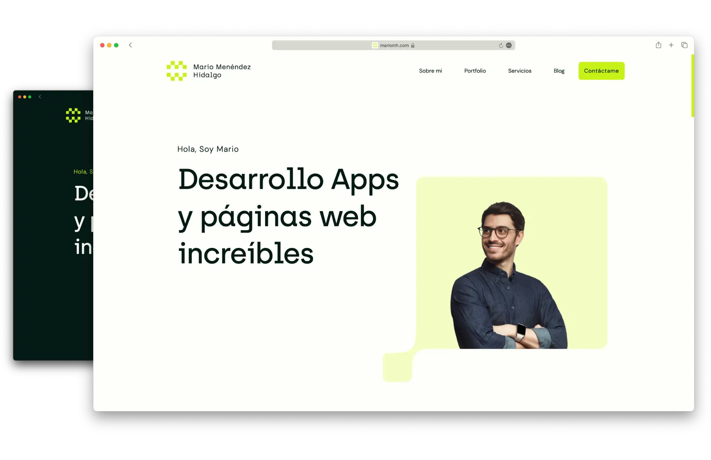

<h1 align="center">
  mariomh.com
</h1>

<p align="center">
    Portfolio personal
</p>



## Tecnologías

- **Runtime** - [Bun](https://bun.sh)  
- **Frontend** - [Astro](https://astro.build/)  
- **Styling** - [TailwindCSS](https://tailwindcss.com/)  
- **Deployment** - [Firebase](https://firebase.google.com/)  
- **Languages** - [TypeScript](https://www.typescriptlang.org/)


## Ejecutar proyecto

Clonar el proyecto

```bash
git clone https://github.com/MarioMH8/mariomh.com.git
```

Acceder al directorio del proyecto

```bash
cd mariomh.com
```

Crea el archivo `.env` con las [variables de entorno](#variables-de-entorno)

**.env**

```.dotenv
PUBLIC_FIREBASE_API_KEY=AIzaSyBa....
PUBLIC_FIREBASE_APP_ID=1:77.....:web:438....
PUBLIC_FIREBASE_AUTH_DOMAIN=<project>.firebaseapp.com
PUBLIC_FIREBASE_MESSAGING_SENDER_ID=77....
PUBLIC_FIREBASE_STORAGE_BUCKET=<project>.appspot.com
PUBLIC_FIREBASE_PROJECT=<project>
PUBLIC_FIREBASE_APPCHECK_DEBUG_TOKEN=<uuid v4>
PUBLIC_RECAPTCHA_SITE_KEY=6Ld....
```

La primera instalación tendrás que actualizar el valor de `$TOKEN` del archivo [bunfig.toml](bunfig.toml)
con el valor que devuelve el commando:

> Debes de estar autenticado con `gcloud` con un usuario que tenga acceso al proyecto [Google Cloud](https://console.cloud.google.com/home/dashboard?project=mariomh-com).

```bash
gcloud auth print-access-token
```

Instalar dependencias

```bash
bun install
```

Ejecutar servidor

```bash
bun dev
```

## Desplegar proyecto

Accede a la GitHub Action [Deploy to Firebase](https://github.com/MarioMH8/mariomh.com/actions/workflows/firebase-deploy.yml) y ejecuta el workflow.

## Estructura del proyecto

El proyecto está organizado en varios directorios y archivos principales:

- `src/`: Este directorio contiene todo el código fuente del proyecto. 
    - `assets/`: Contiene las imágenes del proyecto que se procesan y optimizan con Astro.
    - `components/`: Contiene los componentes de Astro que se utilizan en varias partes de la aplicación.
    - `content/`: Configuración del contenido de Astro.
    - `features/`: Contiene los componentes específicos del proyecto.
    - `layouts/`: Contiene el layout base de la página.
    - `pages/`: Contiene los componentes de Astro que representan las páginas de la aplicación.
- `public/`: Este directorio contiene todos los archivos estáticos.
